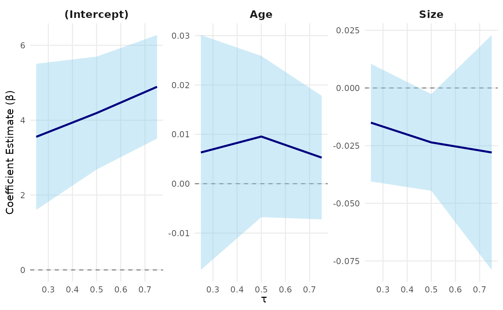

# curequantile: An R Package for Quantile Cure Regression Models

The `curequantile` package can be used to fit quantile regression model
for censored time-to-event data with a cure fraction.

To illustrate the functionality of the `curequantile` package, we first
load the necessary libraries and the `breast_data` dataset. The data
consist of 462 women from county code 175 (Union of Iowa, Morgan of
Kentucky, and Laurens of Georgia) diagnosed with localized or regional
breast cancer between 2004 and 2017, extracted from the Surveillance,
Epidemiology, and End Results (SEER) database.

``` r

library(curequantile)
library(survival)
library(maxLik)
#> Loading required package: miscTools
#> 
#> Please cite the 'maxLik' package as:
#> Henningsen, Arne and Toomet, Ott (2011). maxLik: A package for maximum likelihood estimation in R. Computational Statistics 26(3), 443-458. DOI 10.1007/s00180-010-0217-1.
#> 
#> If you have questions, suggestions, or comments regarding the 'maxLik' package, please use its GitHub page and the issues there:
#> https://github.com/arne-henningsen/maxLik
data("breast_data")
head(breast_data)
#>   Time Delta Age Size Surgery ER PR
#> 1   83     0  74    9       1  0  0
#> 2   37     0  69   13       1  1  1
#> 3   46     0  71   23       1  0  0
#> 4   26     0  61   10       1  0  0
#> 5  117     0  58   13       1  1  1
#> 6  114     0  60   21       1  1  0
```

A cure quantile regression model can be fit using the `curequantile`
function.

``` r

fit_breast <- curequantile(Surv(log(Time), Delta) ~ Age + Size,
  data = breast_data, subset = 1:200)
```

The [`coef()`](https://rdrr.io/r/stats/coef.html) function extracts the
parameter estimates at a specific quantile `tau`.

``` r

coefficients <- coef(fit_breast, tau = 0.50)
names(coefficients)
#> [1] "gamma_est" "eta_est"   "beta_est"
coefficients$gamma_est
#> (Intercept)         Age        Size 
#> -4.41474767  0.03760906  0.03203235
coefficients$beta_est
#> (Intercept)         Age        Size 
#>  4.19057671  0.00955579 -0.02360217
```

Here, `gamma_est` contains the incidence parameter estimates, while
`beta_est` contains the latency parameter estimates at the specified
quantile, `tau`. Finally, `eta_est` gives the conditional probabilities
of being susceptible, and therefore has a length equal to the number of
rows in the input data frame.

Alternatively, [`print()`](https://rdrr.io/r/base/print.html) prints the
coefficients at the user-specified quantile `tau` to the console.

``` r

print(fit_breast, tau = 0.50)
#>        (Intercept)  Age        Size     
#> gamma  -4.414748     0.037609   0.032032
#> beta    4.190577     0.009556  -0.023602
```

The [`summary()`](https://rdrr.io/r/base/summary.html) function returns
the parameter estimates, bootstrap standard errors, $`Z`$-test
statistics, $`p`$-values, and bootstrap confidence intervals for both
the incidence covariates and the latency covariates at the specified
quantile, `tau`. For computational speed, this vignette uses `b = 5`
bootstrap resamples, whereas the function defaults to `b = 200`.

``` r

summary <- summary(fit_breast, tau = 0.50, b = 5)
#> Warning in colnames(gamma_hat)[1:4] <- c("gamma_est", "gamma_se", "Z",
#> "Pvalue", : number of items to replace is not a multiple of replacement length
```

The [`plot()`](https://rdrr.io/r/graphics/plot.default.html) function
displays the quantile parameter estimates for latency and their
corresponding confidence intervals for each covariate across the
user-specified range of `tau`. For illustration, only b = 10 bootstrap
resamples are used here.

``` r

plot(fit_breast, tau = seq(0.25, 0.75, by = 0.25), b = 10, seed = 2)
```



Additional S3 methods available for `curequantile` objects include:

- [`dim()`](https://rdrr.io/r/base/dim.html): Returns the number of
  observations along with the number of incidence and latency
  covariates.
- [`formula()`](https://rdrr.io/r/stats/formula.html): Extracts the
  model formula.
- [`logLik()`](https://rdrr.io/r/stats/logLik.html): Returns the
  log-likelihood of the fitted model.
- [`nobs()`](https://rdrr.io/r/stats/nobs.html): Returns the number of
  observations used to fit the model.
- [`predict()`](https://rdrr.io/r/stats/predict.html): Generates
  predictions from the fitted model.
